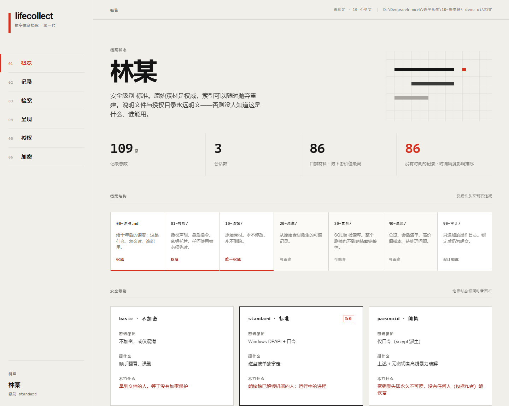
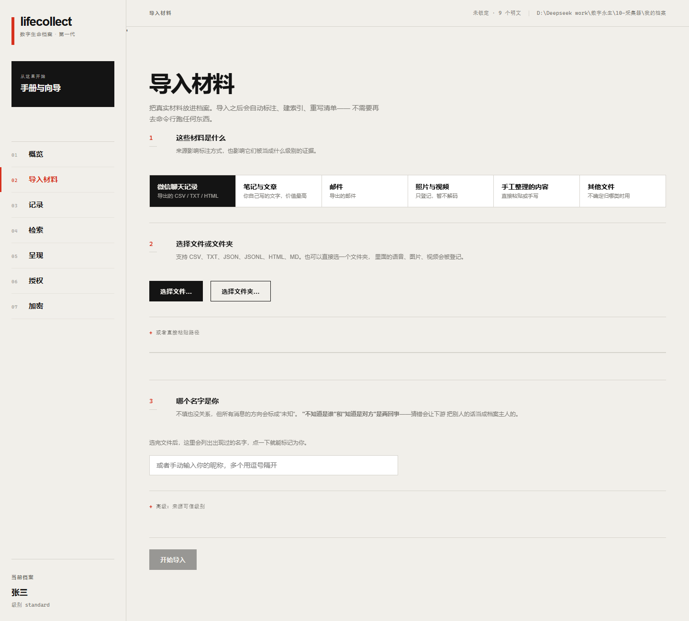
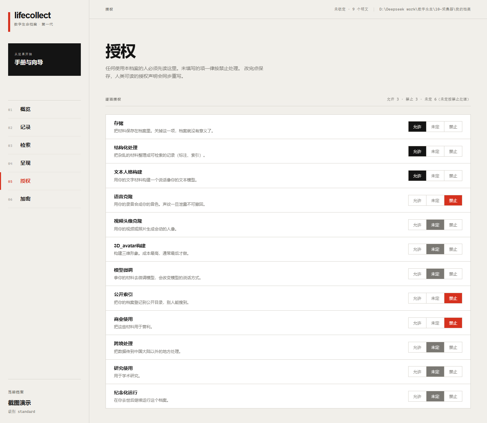

# lifecollect · 数字生命档案

> 把散落在微信、笔记、照片、邮件里的材料，收拢成一套**不依赖任何软件、二十年后仍然能读**的档案。

一个离线优先的采集与归档工具，配一份完整的档案标准。**它不是"克隆人"的工具**——不训练模型、不克隆声音、不生成任何合成内容。它只负责把材料留住，并标注清楚哪些材料值得用。



---

## 为什么做这个

现有工具都从「材料已经整理好了」这一步开始。现实中所有人卡在第一步：

- **材料散在多个 App 里**，导不出来，或者导出来是一堆格式各异的文件
- **材料单向衰减**——人在世时可采，人走之后账号被回收、手机被重置、记录被删
- **原始素材里没有「哪条是闲聊、哪条是观点」的信息**，而下游的模型训练需要它

所以这个工具站在所有下游工具的上游，只做两件事：**采集**和**标注**。

做完之后你会得到一个文件夹。用文件管理器打开，用记事本就能看：

```
档案/
├── 00-说明.md          ← 永远明文。告诉十年后的读者这是什么、谁能用
├── 01-授权/            ← 授权声明、身后指令、密钥托管。任何使用者必须先读
├── 10-原始/            ← 原始素材。永不修改、永不删除。这是唯一的权威
├── 20-派生/            ← 从原始素材派生的可读记录。坏了能重新生成
├── 30-索引/            ← SQLite 检索库。整个删掉也不影响档案完整性
├── 40-呈现/            ← 总览、会话清单、高价值样本、待处理问题
└── 90-审计/            ← 操作日志，只追加
```

**核心约束：权威性在文件上，不在数据库上。** 生成它的软件哪天不存在了，档案依然是完整的。

---

## 它明确不是什么

软件界面上和文档里都反复写了这几条，因为这是这个项目最容易被人误解的地方：

- ❌ **不是「复活人类」或「克隆人格」的工具**。它是采集器，不是生成器。
- ❌ **不是永生的保证**。它能做的是「让材料活下来」，不是「让人活下来」。
- ❌ **不是法律合规的保证**。使用者需自行承担合规责任。
- ❌ **不是成熟的生产系统**。v0.1，一个人在写，接口会变。

---

## 它能做什么

### 1. 建档案，选安全级别

三个级别由用户选，但界面必须同时显示「挡什么」和「**不挡什么**」：

| 级别 | 密钥保护 | 挡什么 | 不挡什么 |
|---|---|---|---|
| `basic` | 无 | 顺手翻看、误删 | **拿到文件的人。等于没有加密保护** |
| `standard` | Windows DPAPI + 口令 | 磁盘被单独拿走 | 能接触已解锁机器的人 |
| `paranoid` | 仅口令（scrypt 派生） | 上述 + 离线暴力破解 | **密钥丢失即永久不可读** |

一个说不出自己保护边界的加密开关，比没有加密更危险。所以每一级都强制显示第三列。

### 2. 导入材料

12 种扩展名：`.csv .tsv .jsonl .ndjson .json .html .htm .xhtml .txt .log .md .text`

自动编码探测（UTF-8 / BOM / GB18030 / UTF-16）、列名识别、目录导入登记媒体、重跑幂等。
**不猜发送者**：不指定 `--self` 时所有消息方向标 `unknown`。

界面里有三步导入向导，不需要命令行：



### 3. 自动标注内容类型

7 类，每条记录都带**判定规则**和**置信度**：

| 类型 | 对下游价值 | 判定依据 |
|---|---|---|
| `authored` | 最高 | 来源是自撰文本 |
| `chat_opinion` | 高 | 观点词 + 长度 ≥ 8 |
| `chat_emotion` | 高 | 情绪词 / 标点爆发 / 省略号 / 语气词 |
| `chat_media` | 高（音色来源） | 媒体标记 |
| `chat_casual` | 低 | 短消息 / 常用语 |
| `third_party` | 零 | 别人写给他的 |
| `unknown` | 未知 | **兜底，不硬塞进某一类** |

命不中任何规则的标 `unknown` + `weak`，不假装确定。**错误的分类比没有分类更糟**。

### 4. 中文检索

内置分词器对中文都不可用（`unicode61` 把整句当一个词，`trigram` 要求至少三字），所以自己做了字符级索引。1 字、2 字、多字、跨词边界都能查。

**短语匹配要求连续**：`拍照` 不会命中「拍了几张照片」。这是有意设计——宁可漏，不可错。

### 5. 加密

AES-256-GCM 认证加密，分块处理大文件，每文件独立子密钥，块序号进 AAD。改一个字节解密必须失败。

**永远明文的文件**（设计约束，不是遗漏）：`00-说明.md`、`01-授权/`、`90-审计/`、`密钥信封.json`、`加密清单.json`、`_meta.json`。

> `90-审计/` 明文的原因：加锁操作本身要写日志。加密它会导致「加密 → 写日志 → 新明文」永不收敛。

### 6. 授权表单

12 类粒度逐项开关（允许 / 未定 / 禁止），**未定一律按禁止处理**。保存时同步重写人类可读的 `授权声明.md`。



### 7. 可选：AI 协助

默认关闭，唯一会联网的功能。两个用法：

- **起草**（用于外部公开材料）—— AI 写新文字，风险高，必须人工核对
- **批量整理**（用于已有材料）—— AI 把已有记录归纳成时间线/人物/主题/存疑清单，**每条结论强制标出处记录 ID**

所有 AI 产出都标 `source=ai_assisted`、`kind=ai_drafted`，**绝不会被当成本人写的语料**。

---

## 快速开始

```powershell
# 依赖只有两个
pip install -r 10-采集器/requirements.txt

Set-Location 10-采集器

# 1. 建档案
python -m lifecollect init --root "D:\我的档案" --security-level standard --subject "张三"

# 2. 导入（--self 是你在导出文件里的昵称，必须给对）
python -m lifecollect import --root "D:\我的档案" --source wechat --self "我" 聊天记录.csv

# 3. 标注 → 索引 → 出清单（顺序不能反）
python -m lifecollect tag   --root "D:\我的档案"
python -m lifecollect index --root "D:\我的档案"
python -m lifecollect view  --root "D:\我的档案"

# 4. 加密
python -m lifecollect lock  --root "D:\我的档案"

# 5. 桌面界面（pywebview，需要 WebView2）
python -m lifecollect.ui --root "D:\我的档案"
```

**先看效果再建真档案**：`python demo_ui.py` 会生成一份合成数据的演示档案。

---

## 测试

```powershell
Set-Location 10-采集器
python -m unittest discover -p "*test.py"    # 103 个用例
```

测试里有一半在测「**不该成功的时候必须失败**」：

- 密文改任意一个字节 → 必须被发现
- A 文件的密文当作 B 文件解 → 必须失败
- 错误口令 → 必须拒绝，不能被 DPAPI 绕过
- 不指定 `--self` → 方向必须标 `unknown`，不能猜
- 抠不出时间 → 必须是 `None`，不能拿导入时间冒充
- AI 起草的内容 → **必须标 `ai_drafted`，绝不能标 `authored`**

---

## 技术选型与理由

| 选择 | 理由 |
|---|---|
| **只依赖 `cryptography` 和 `pywebview`** | 加密不能自己写——密码学实现错了不会报错，看起来能工作，实际不安全。界面用系统 WebView2，不打包 Chromium |
| **中文检索自己做字符级索引** | 实测内置分词器对中文都不可用，见 `store.py` 注释 |
| **索引层可整个删除重建** | 权威在文件，不在数据库 |
| **加密先验证再删明文** | 反过来做，中途失败就是永久丢数据 |
| **换口令只重包主密钥** | 不重新加密档案，快且不会碰到数据 |

---

## 已知限制

| 限制 | 影响 |
|---|---|
| 微信数据库直读未做 | 需要第三方工具先导出 CSV/HTML/TXT |
| 语音消息不解码 | SILK 格式只登记，转码需要 ffmpeg |
| 密钥托管未实现 | 秘密共享方案已设计，代码未写 |
| 会话标题不进索引 | 只能搜消息内容 |
| 中文短语要求连续 | 搜「拍照」不命中「拍了几张照片」 |
| 仅 Windows 优先 | 平台相关代码已隔离，但 macOS 未测试 |

---

## 仓库结构

```
00-标准/                档案标准与设计文档
├── 档案标准-v0.1.md     目录约定、元数据字段、授权格式、安全级别
├── DLRS核查备忘.md      对上游标准的实测核查记录
└── 当前状态.md          能做什么、不能做什么

10-采集器/              实现
├── lifecollect/        核心包（采集/标注/索引/加密/界面）
├── selftest.py         采集链路测试
├── encrypt_test.py     加密测试
└── demo*.py            演示数据生成器

docs/screenshots/       界面截图
```

---

## 相关项目

- [DLRS (Digital Life Repository Standard)](https://github.com/Digital-Life-Repository-Standard/DLRS) —— 一个成熟的 `.life` 档案格式与运行时协议标准（MIT）。本项目的标准与其对齐，但**不依赖其代码**：只复用它的 schema 契约，避免被它的实现 bug 和版本变动拖累。核查记录见 [`00-标准/DLRS核查备忘.md`](00-标准/DLRS核查备忘.md)。
- [PyWxDump](https://github.com/xaoyaoo/PyWxDump) / [WeChatMsg](https://github.com/binary2010/WeChatMsg-2025) —— 微信记录导出工具（非官方，有版本兼容风险）。

---

## 授权与伦理

这个项目处理的是**一个人的全部私人材料**。所以：

1. **只处理你有权处理的材料。** 自己的数据，或者有明确授权的数据。
2. **档案里天然包含第三方的私人内容**（聊天记录必然如此）。任何对外发布前必须脱敏。
3. **用档案生成的一切内容必须标记为 AI 合成。** 这是使用者的义务，不是建议。
4. **不要用它复现未经同意的人。**

---

## License

MIT，见 [LICENSE](LICENSE)。
